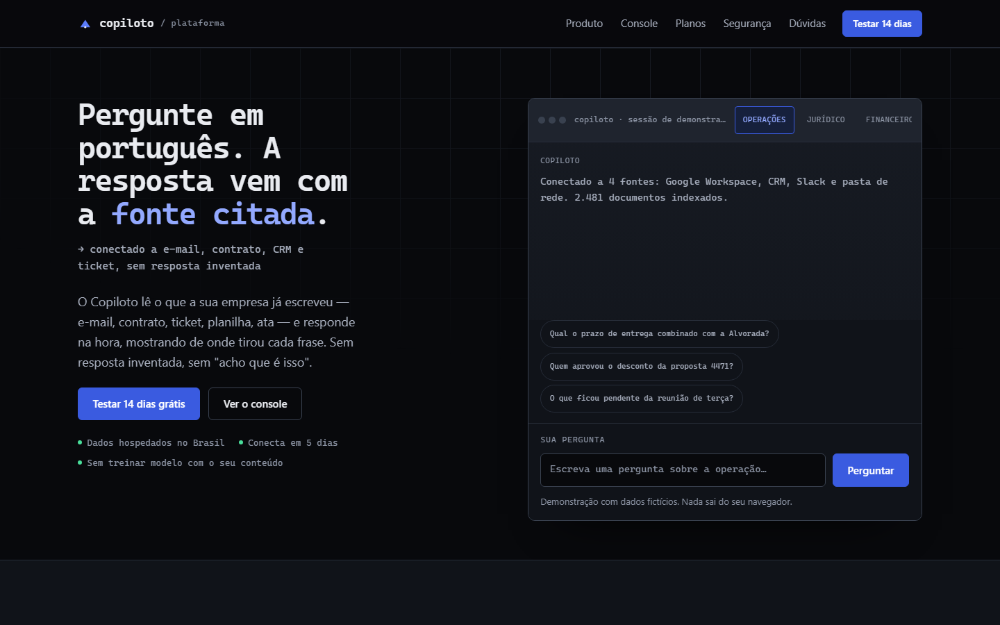
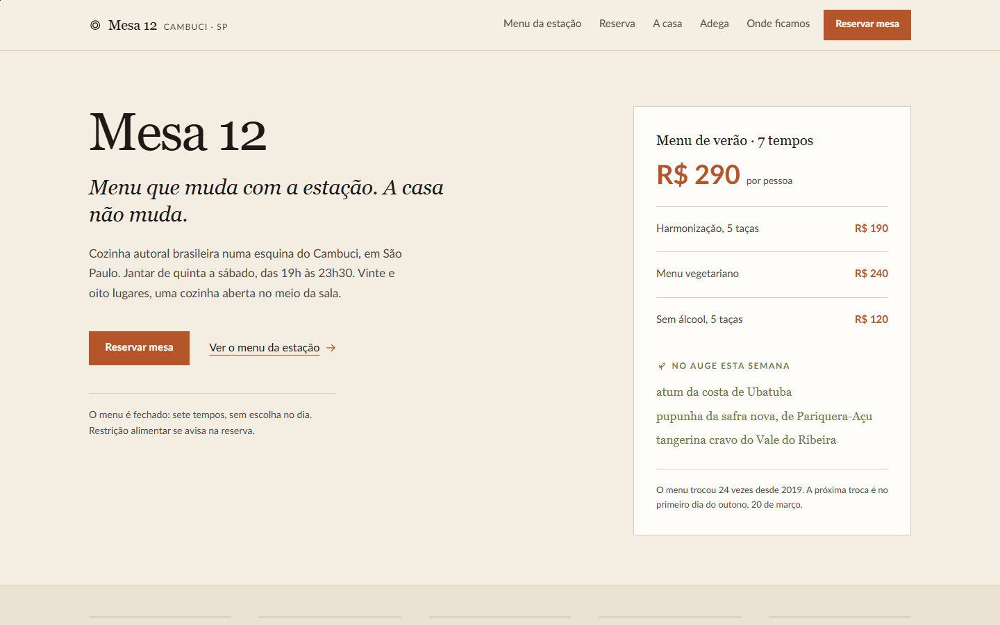
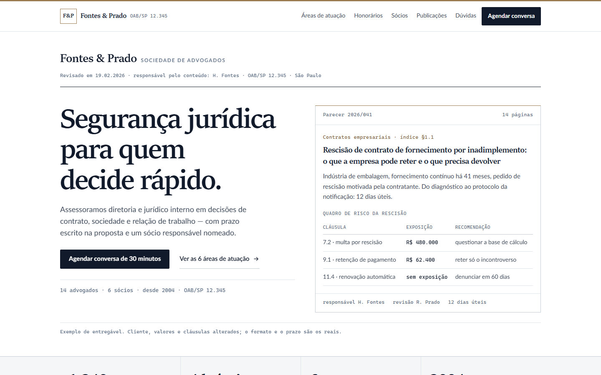
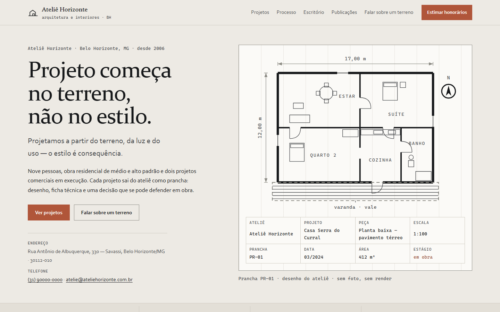
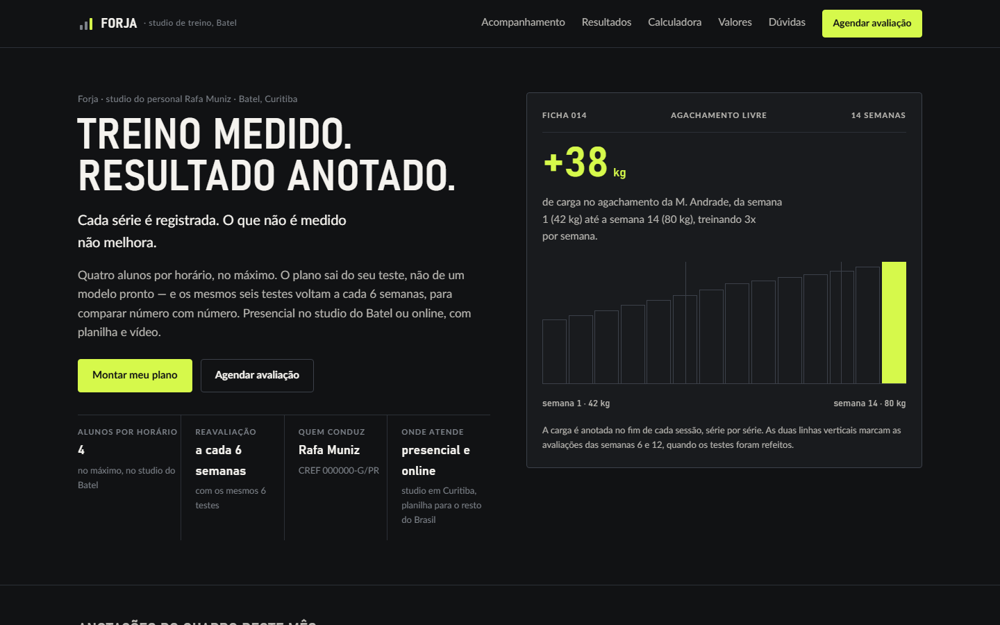
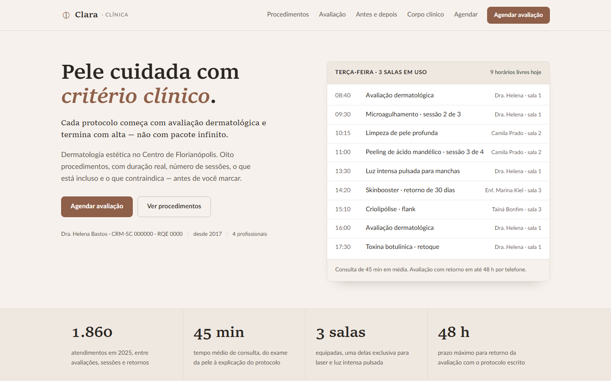
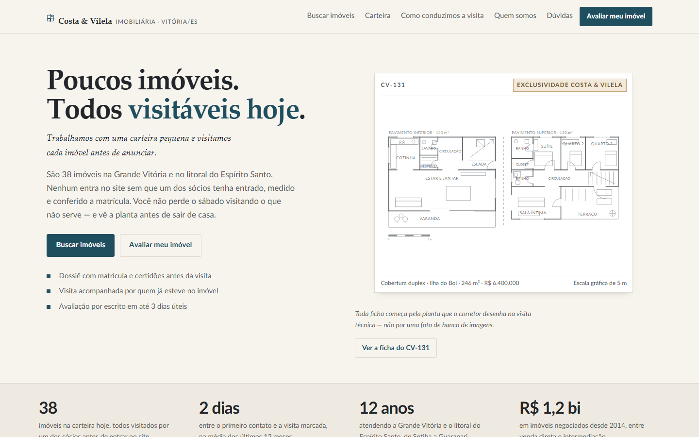
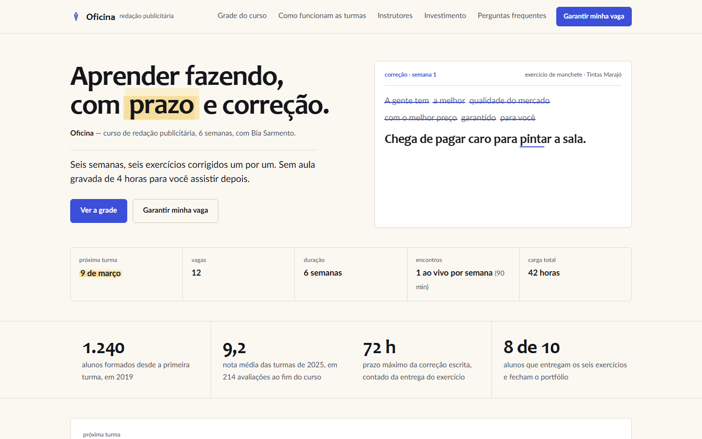
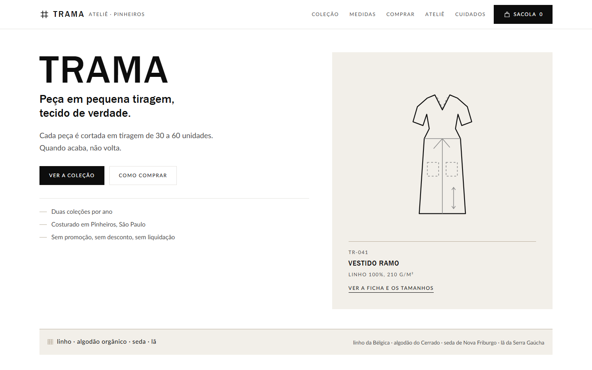
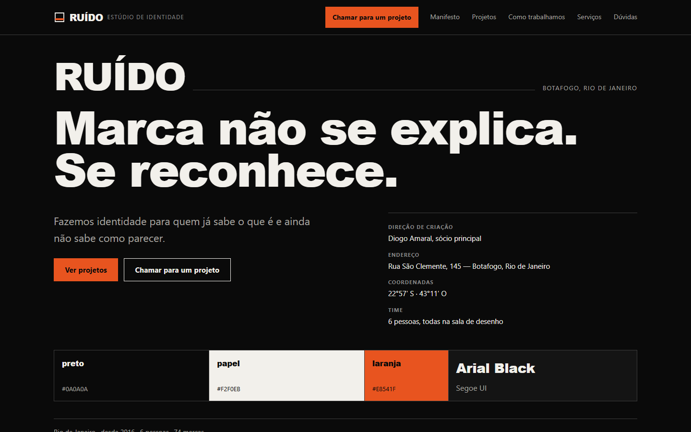

# Catálogo de modelos de site — Nortear Estúdio

Dez sites completos, um por tipo de negócio, prontos para apresentar e vender — agora como
aplicação **Next.js 16** (App Router, TypeScript, rotas estáticas). Preços de implantação de
**R$ 300 a R$ 1.500**, definidos em `app/data/catalogo.ts`.

<p align="center">
  
  
  
  
  
</p>
<p align="center">
  
  
  
  
  
</p>

```bash
npm install
npm run dev          # http://localhost:3000
npm run build        # build de produção
npm start            # serve o build
```

## Rotas

| Rota | O que é |
|---|---|
| `/` | O catálogo: 10 modelos, comparação, pacotes em R$, processo, dúvidas e orçamento |
| `/modelos/saas-ia` | 01 · Copiloto — SaaS de IA |
| `/modelos/restaurante` | 02 · Mesa 12 — restaurante autoral |
| `/modelos/advocacia` | 03 · Fontes & Prado — advocacia empresarial |
| `/modelos/arquitetura` | 04 · Ateliê Horizonte — arquitetura e interiores |
| `/modelos/fitness` | 05 · Forja — personal trainer e studio |
| `/modelos/clinica` | 06 · Clara — clínica de estética |
| `/modelos/imobiliaria` | 07 · Costa & Vilela — imobiliária boutique |
| `/modelos/curso` | 08 · Oficina — curso online |
| `/modelos/moda` | 09 · Trama — moda autoral |
| `/modelos/estudio` | 10 · Ruído — estúdio criativo |

Todas as rotas são **pré-renderizadas como estáticas** no build: carregam sem servidor de aplicação e
podem ser publicadas em qualquer hospedagem (Vercel, Netlify, Cloudflare Pages, S3).

## Como o projeto está organizado

```
app/
  (catalogo)/              ← route group: root layout próprio do catálogo
    layout.tsx             ← <html>, metadata, SEO
    page.tsx               ← a página do catálogo
    globals.css            ← importa assets/fonts.css e assets/catalogo.css
    components/            ← GradeModelos, FormularioOrcamento, Revelar (client components)
  modelos/
    <slug>/
      layout.tsx           ← root layout do modelo: metadata, theme-color e o CSS do modelo
      page.tsx             ← markup convertido do modelo estático
      Interacoes.tsx       ← o script do modelo, como client component
  data/
    catalogo.ts            ← FONTE ÚNICA dos dados, tipada
assets/
  catalogo.css             ← sistema visual do catálogo (usado pelo Next e pela versão estática)
  fonts.css                ← as vozes tipográficas
  modelos-data.js          ← GERADO a partir de app/data/catalogo.ts (CommonJS, para os scripts)
  thumbs/*.png             ← prévias dos 10 modelos
modelos/
  NN-slug/                 ← a versão estática original de cada modelo (index.html, estilo.css,
                             modelo.json, DESIGN.md) — serve de referência e de baseline de teste
public/thumbs/             ← cópia das prévias, servida pelo Next
docs/                      ← contrato de craft, briefings, guia de migração
scripts/                   ← captura, medição, detector, sincronização de dados
```

### Por que cada modelo tem o próprio root layout

São dez identidades visuais distintas, cada uma com o seu `<html lang>`, `theme-color`, favicon e
folha de estilo. Um layout compartilhado faria o CSS de um modelo vazar para os outros — foi
exatamente o bug que apareceu na migração: a regra de duas colunas do catálogo entrou na página do
modelo 01 e mudou a altura de todas as seções. Route groups resolvem isso com um root layout por
grupo. **Não crie um layout compartilhado para os modelos.**

### Como a interação funciona

Os modelos nasceram como HTML estático com um IIFE no fim do `<body>`. Na migração o markup virou
JSX e o script virou um client component (`Interacoes.tsx`) que roda uma vez no `useEffect` e liga os
controles consultando o DOM já renderizado pelo React. O comportamento é o mesmo — foi o que a
verificação por pixel comprovou.

Se for reescrever essas interações em React idiomático (estado em vez de manipulação de DOM), faça um
modelo por vez e rode `npm run fidelidade` para garantir que o desenho não mudou.

## Onde mexer

| Quero mudar | Arquivo |
|---|---|
| Nome, WhatsApp, e-mail, CNPJ da agência | `app/data/catalogo.ts` → `AGENCIA` |
| Preços dos pacotes | `app/data/catalogo.ts` → `PACOTES` |
| Preço de um modelo | `app/data/catalogo.ts` → `MODELOS[].preco` |
| Nome, promessa ou texto de um modelo no catálogo | `app/data/catalogo.ts` → `MODELOS[]` |
| O conteúdo de dentro de um modelo | `app/modelos/<slug>/page.tsx` |
| O visual de um modelo | `modelos/NN-slug/estilo.css` (o Next importa direto desse arquivo) |
| O visual do catálogo | `assets/catalogo.css` |

Depois de mudar `app/data/catalogo.ts`, rode:

```bash
node scripts/sincronizar-dados.mjs     # espelha para assets/modelos-data.js
```

Os dois arquivos existem porque os scripts de captura rodam fora do bundler e não leem TypeScript.
`node scripts/sincronizar-dados.mjs --conferir` diz se estão iguais (útil em CI).

## Verificação

```bash
npm run typecheck                      # tsc --noEmit
npm run build                          # build de produção
npm run verificar                      # 11 rotas x 1440 e 390: rolagem, alvos, imagens, título
npm run auditar                        # auditoria técnica: contraste, foco, semântica, tokens
npm run auditar:foco                   # foco com a tecla Tab de verdade (25 paradas por rota)
npm run fidelidade                     # pixel a pixel: Next x versão estática
npm run interacao                      # clica nos controles e confere se respondem
npm run detectar                       # anti-padrões do Impeccable por modelo
npm run thumbs                         # regera as prévias do catálogo
npm run dados:conferir                 # os dois arquivos de dados estão iguais?
npm run toque:conferir                 # o piso de área de toque está nos 10 modelos?
node scripts/auditar.mjs --largura 390
node scripts/contraste.mjs "#6B7382" "#F7F5F0" 4.5   # acha o valor que passa no contraste
node scripts/geometria.mjs <id>        # geometria bloco a bloco
node scripts/detalhe-secao.mjs <id> "<seletor>"       # propriedades computadas de um elemento
```

O relatório da última auditoria está em [docs/AUDITORIA.md](docs/AUDITORIA.md): nota **19/20**, com os
achados, as correções e os falsos positivos que foram descartados.

`fidelidade.mjs` captura a mesma página nas duas versões e compara os PNGs. Ele também captura a
versão estática **duas vezes** como controle: se essas duas já diferirem, a página tem conteúdo
dinâmico (relógio, texto sendo escrito) e a comparação precisa ser lida com essa folga.

`interacao.mjs` é o complemento necessário: fidelidade por pixel prova o desenho, mas não prova que
os controles funcionam. Ele clica de verdade — filtra a coleção, abre o menu, busca imóvel, calcula
orçamento, envia formulário vazio para conferir a validação.

Estado atual, medido:

| Verificação | Resultado |
|---|---|
| `verificar` — 11 rotas × 2 larguras | **22/22 sem problema** |
| Auditoria técnica (5 dimensões) | **19/20 — Excellent** |
| Contraste WCAG medido | **3.077 trechos, zero abaixo do piso** |
| Foco por teclado | **273/275 paradas com indicador visível** |
| Fidelidade por pixel, 1440px | **10/10 idênticas** à versão estática |
| Fidelidade por pixel, 390px | **10/10 idênticas** |
| Interação (8 fluxos reais) | **8/8 funcionando** |
| `tsc --noEmit` | limpo |
| `next build` | 13 rotas, todas estáticas |
| Dados em sincronia (`.ts` ↔ `.js`) | iguais |
| Piso de área de toque nos 10 modelos | em sincronia |

Os comandos que abrem o Chrome precisam rodar **fora de sandbox restrito** (o Chrome usa named pipes
entre processos e é bloqueado em modo confinado). Cada script usa um perfil e uma porta de depuração
por processo, então rodar dois em paralelo não derruba mais o navegador.

**Atenção ao medir:** rodar `fidelidade.mjs` durante um `next build` dá divergência falsa — o
servidor fica servindo um `.next` que acabou de ser apagado. Espere o build terminar e reinicie o
servidor antes de conferir.

## O que é fictício e precisa ser substituído antes de vender

- Nomes de negócio, pessoas, endereços, telefones, CNPJ, CRECI, CRM, OAB, CREF.
- Preços, prazos e números de resultado.
- Depoimentos e casos.
- **Não há nenhuma foto.** Os desenhos (plantas baixas, moldes de roupa, elevações, gráficos) são SVG
  autoral. Onde o cliente tiver foto, ela entra no lugar do desenho.

## Se for publicar

O formulário de orçamento valida de verdade e monta o escopo na tela, mas **não envia para servidor
nenhum**. Para receber os pedidos, ligue o `onSubmit` de `app/(catalogo)/components/FormularioOrcamento.tsx`
a um endpoint (Formspree, Resend, webhook do seu CRM) ou a uma Server Action.

O rodapé de cada modelo e o do catálogo já trazem o aviso de que o conteúdo é demonstração.

## A versão estática continua no repositório

`modelos/NN-slug/` guarda o HTML, o CSS e o `DESIGN.md` originais de cada modelo, e
`estatico/catalogo.html` guarda o catálogo em HTML puro. **Nada disso é usado em produção:** o Next
serve tudo. Eles existem como referência do desenho e como baseline do teste de fidelidade.

Para abrir o catálogo estático direto do disco, sirva a raiz: `estatico/catalogo.html` referencia
`../assets/`, que continua no lugar.

Se quiser descartar a versão estática, apague `modelos/` e `estatico/` e ajuste `scripts/fidelidade.mjs`,
`scripts/geometria.mjs`, `scripts/interacao.mjs` e `scripts/extrair-modelo.mjs`, que leem de lá.
